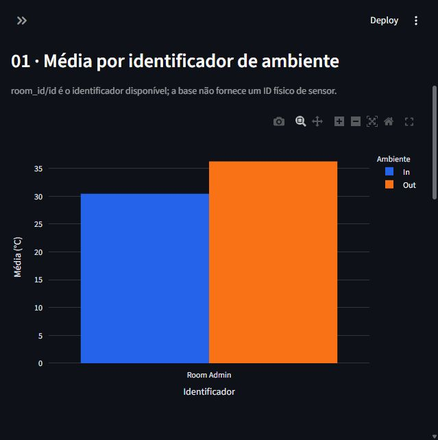
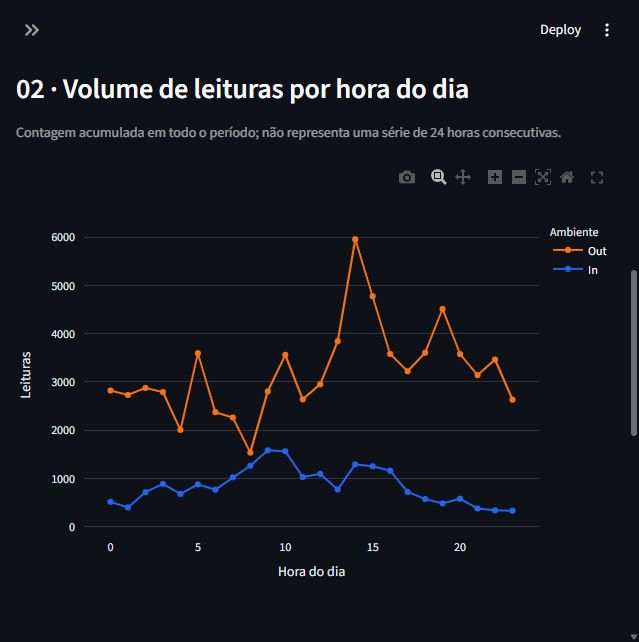
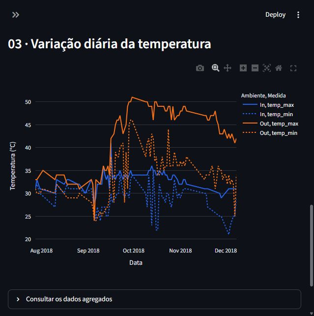

# Pipeline de Dados com IoT e Docker

**Jacqueline dos Santos Vivot · RA 125866**  
Disruptive Architectures: IoT, Big Data e IA

Pipeline em lote que transforma leituras históricas de temperatura do Kaggle, grava no PostgreSQL e consulta três views em um dashboard Streamlit com gráficos Plotly.

## Arquitetura

`CSV do Kaggle → pandas (validação) → SQLAlchemy → PostgreSQL → views SQL → Streamlit / Plotly`

Docker Compose coordena o banco, a carga e o dashboard. O dashboard só inicia quando a carga termina com sucesso; o banco usa volume persistente e verificação de saúde. A porta do dashboard é disponibilizada somente no computador local.

## Executar com Docker

1. Instale o [Docker Desktop para Windows](https://docs.docker.com/desktop/setup/install/windows-install/) com backend WSL 2. Se solicitado, habilite virtualização e reinicie o Windows. Abra o Docker Desktop e aguarde o mecanismo ficar pronto.
2. Baixe o CSV na [página do Kaggle](https://www.kaggle.com/datasets/atulanandjha/temperature-readings-iot-devices) e salve como `data/IOT-temp.csv`. Com Python instalado, também pode usar `python scripts/download_data.py`.
3. No PowerShell, na pasta do projeto:

```powershell
Copy-Item .env.example .env
# Edite POSTGRES_PASSWORD no arquivo .env antes de continuar.
docker compose up --build -d
docker compose logs pipeline
docker compose ps -a
```

4. Abra **http://localhost:8501**. O serviço `pipeline` deve terminar com código 0; `db` e `dashboard` devem continuar em execução.

```powershell
# Confirmar registros e views no banco
docker compose exec db psql -U iot -d iot -c "SELECT COUNT(*) FROM temperature_readings;"
docker compose exec db psql -U iot -d iot -c "SELECT * FROM avg_temp_por_dispositivo;"
# Reprocessar o mesmo CSV (não duplica IDs)
docker compose run --rm pipeline
# Parar preservando os dados
docker compose down
```

Os comandos de consulta assumem usuário e banco `iot`. Se alterar esses valores no `.env`, ajuste os comandos. A senha inicial pertence ao volume do PostgreSQL: editar o `.env` depois não altera a senha já gravada no banco.

## Python local e testes

```powershell
python -m venv .venv
.venv\Scripts\python -m pip install -r requirements.txt
.venv\Scripts\python -m pip install pytest
.venv\Scripts\python -m pytest -q
```

Para usar PostgreSQL existente, configure `DATABASE_URL` ou `DB_HOST`, `POSTGRES_DB`, `POSTGRES_USER` e `POSTGRES_PASSWORD`. Depois execute:

```powershell
.venv\Scripts\python -m src.pipeline --csv data/IOT-temp.csv
.venv\Scripts\python -m streamlit run src/dashboard.py
```

Não publique senhas. O arquivo `.env` é ignorado pelo Git. A execução com Docker não exige instalar Python no Windows se o CSV for baixado manualmente.

## Tratamento dos dados

- Validação das cinco colunas obrigatórias e remoção de espaços nos identificadores.
- Conversão explícita de datas com formato `%d-%m-%Y %H:%M`, sem inferência ambígua de mês/dia.
- Rejeição de valores ausentes, datas inválidas, temperaturas não finitas e ambientes fora de `In`/`Out`.
- Remoção de IDs idênticos duplicados; IDs repetidos com conteúdo divergente interrompem a carga.
- Inserção/atualização por chave primária em uma transação. Reexecutar o arquivo não duplica registros.
- Relatório de contagens em `docs/qualidade.json` após uma carga bem-sucedida. O banco acumula IDs de arquivos anteriores; não é apagado a cada carga.

## Três views SQL

| View | Agrupamento | Propósito |
|---|---|---|
| `avg_temp_por_dispositivo` | Identificador e ambiente | Comparar médias e quantidades de leituras internas/externas |
| `leituras_por_hora` | Hora do dia e ambiente | Identificar concentração das coletas ao longo das 24 horas |
| `temp_max_min_por_dia` | Data e ambiente | Acompanhar máximas, mínimas e médias diárias |

As definições completas estão em `sql/views.sql`. A hora é a registrada no CSV, sem fuso informado. As views são calculadas a partir da tabela ao consultar, não são cópias materializadas.

## Resultados da base

Foram encontradas **97.606 linhas**, **um ID duplicado** e **97.605 leituras válidas**, de **28/07/2018 a 08/12/2018**. Não houve linhas inválidas nesta versão do arquivo.

| Ambiente | Leituras | Média | Mínima | Máxima |
|---|---:|---:|---:|---:|
| Interno (In) | 20.345 | 30,45 °C | 21 °C | 41 °C |
| Externo (Out) | 77.260 | 36,27 °C | 24 °C | 51 °C |

A média externa supera a interna em aproximadamente **5,81 °C**. Isso é uma comparação descritiva: as quantidades e os momentos de coleta são diferentes, portanto não demonstra causalidade ou desempenho de um sistema de refrigeração. A base possui somente `Room Admin`; o gráfico não compara vários sensores identificados individualmente.

Possíveis aplicações incluem alertas de temperatura, apoio à climatização e acompanhamento de ambientes de armazenamento. Limiares precisam ser definidos para cada contexto. Picos devem ser investigados antes de serem tratados como falhas. O projeto usa dados históricos, sem sensores conectados ao vivo ou modelo de IA; uma evolução seria integrar MQTT e detecção de anomalias, com validação temporal.

## Capturas reais do dashboard

Capturadas com as views em PostgreSQL local; a execução Docker neste PC ainda depende da instalação.





## Arquivos

`src/`: carga, conexão e dashboard. `sql/`: tabela e views. `data/`: instruções e CSV local. `tests/`: testes de qualidade. `docs/`: relatório, evidências e roteiro. `scripts/`: utilitários de reprodução.

- [Relatório em PDF](output/pdf/Relatorio-Pipeline-IoT-Jacqueline.pdf)
- [Roteiro para o vídeo](docs/roteiro-video.md)
- [Validação e pendências](docs/validacao.md)

Para reconstruir o relatório: `python -m pip install -r requirements-dev.txt` e `python scripts/build_report.py`.

## Git e entrega

```powershell
git status
git add .
git commit -m "Implementa pipeline IoT, views e dashboard"
git push -u origin main
# Para obter atualizações em outro computador:
git pull --ff-only
```

Repositório: https://github.com/jacqueline-vivot/Pipeline-de-Dados-com-IoT-e-Docker

Para a entrega, confirme que o repositório está público, anexe o PDF e grave o vídeo de até quatro minutos seguindo `docs/roteiro-video.md`. Publique o vídeo como público ou não listado e teste o link sem estar conectado à conta.

## Estado da validação

Os **18 testes automatizados passaram**, incluindo transformação, carga real no PostgreSQL 17 portátil, repetição sem duplicação, atualização de registros, reversão de transação com erro, comparação das três views com pandas e filtros/estados de erro do dashboard. O Compose passou na validação estática pelo esquema oficial. A execução em Docker neste PC fica pendente da instalação do Docker Desktop e WSL, conforme opção da usuária. Consulte `docs/validacao.md` para instruções de reprodução, evidências e limites; não confunda execução local do PostgreSQL com execução em contêiner.
